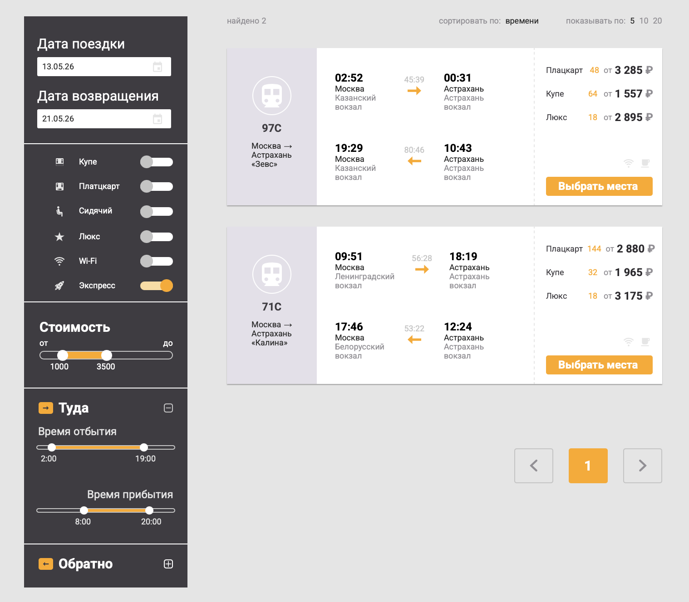

# «Система бронирования ж/д билетов»

SPA-приложение для поиска маршрутов и бронирования железнодорожных билетов.

Проект включает выбор направлений, просмотр поездов, выбор мест в вагонах и оформление заказа.

## Демо

Посмотреть демо можно [здесь](https://professor-severus-snape.github.io/railway-ticket-booking-system/).

## Особенности проекта

- адаптивная кроссбраузерная вёрстка (≥ 768px)
- pixel perfect реализация интерфейса
- методология БЭМ
- SPA-архитектура
- управление состоянием через Redux Toolkit
- маршрутизация через React Router
- валидация [HTML](https://validator.w3.org/) и [CSS](https://jigsaw.w3.org/css-validator/)
- проверка производительности через [PageSpeed Insights](https://pagespeed.web.dev/)

## Технологии

- React
- маршрутизация - React Router
- глобальный стейт менеджер - Redux Toolkit
- типизация - TypeScript
- линтинг - ESLint
- сборка - Vite

## CI/CD

- GitHub Actions - линтинг и сборка проекта (CI)
- GitHub Pages - автоматический деплой приложения (CD)

## Сервер

Проект использует сторонний сервер API.

Сервер работает нестабильно: периодически может отдавать некорректные данные, не возвращать часть информации или быть временно недоступным. По этой причине часть логики и данных была дополнительно обработана на стороне клиента.

## Лицензия

Проект распространяется по лицензии MIT.
